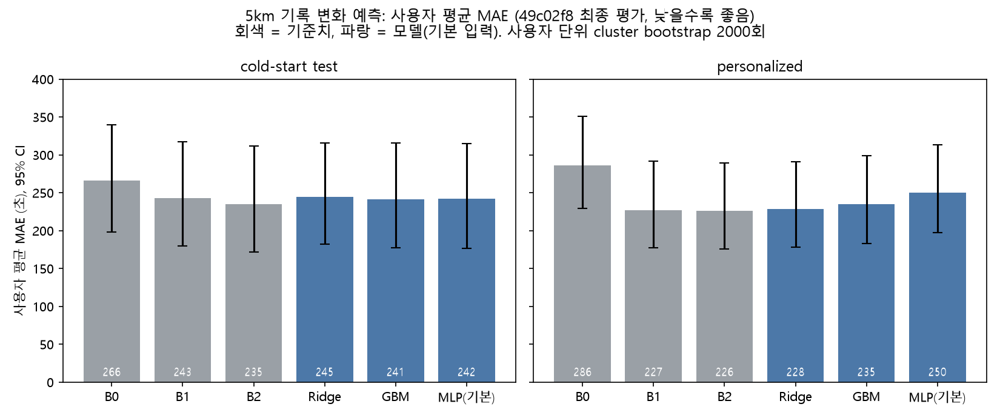
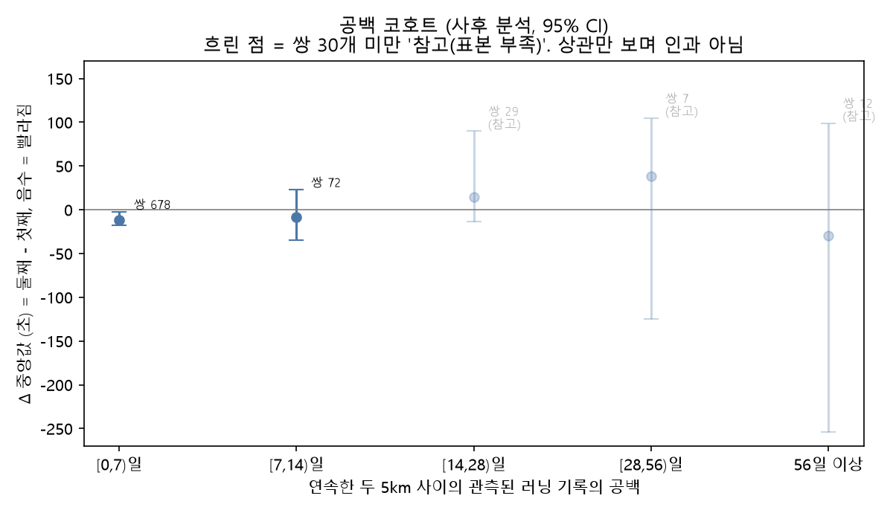

# 5km 기록 변화 예측과 '정직한 기대치 코치'

서강대학교 가상융합전문대학원 「AX 이론과 활용」 수업 프로젝트입니다(FitRec/Endomondo 러닝 기록 사용).

**연구 질문**: 지난 4주 동안 몇 번, 얼마나 멀리, 얼마나 쉬면서 달렸는지로 다음 7일 안 5km 기록의 변화를 예측할 수 있는가(상관관계까지만 주장하며 인과가 아니다).

**주 결론 (최종 평가 커밋 49c02f8, test 1회)**: 지난 4주의 거리·횟수·공백 정보를 넣은 Ridge·GBM·MLP는 cold-start test(71명)와 personalized(250명) 모두에서 '직전 기록이 평소보다 느리면 평소 쪽으로 돌아온다'는 평균 회귀 규칙(B2)보다 사용자 평균 MAE가 통계적으로 낮지 않았고(6개 비교 모두 CI 상한이 0 이상, 모델 − B2 점추정 +1.9~+23.2초), 이는 동등성의 증명이 아니라 이 자료에서 B2를 이긴다는 증거를 찾지 못했다는 뜻이다.



그림 1: 사용자 평균 MAE(초, 낮을수록 좋음)와 사용자 단위 cluster bootstrap 95% CI. 회색 = 기준치(B0 변화 없음, B1, B2 평균 회귀), 파랑 = 기본 입력 모델. 상세: [`docs/final_results_5km.md`](docs/final_results_5km.md).



그림 3: **사후 분석**. 연속한 두 5km 사이의 관측된 러닝 기록의 공백 구간별 기록 변화(둘째 − 첫째) 중앙값과 95% CI. 쌍 30개 미만 구간은 흐리게 표시(참고, 표본 부족). 상관만 보며 인과·처방이 아니다. 상세: [`docs/within_person_results_5km.md`](docs/within_person_results_5km.md). 그림 2(정답 분포)·4(민감도 요약)는 [`docs/figures/`](docs/figures/).

## 시연 프로토타입: 정직한 기대치 코치 (`demo/coach_demo.py`)

위 결론에 따라 모델 대신 **평균 회귀 규칙(B2)만** 사용한다. 직전 28일 안 달리기 4회 이상과 유효 5km 기록 1회 이상이 있어야 예측하고, 부족하면 어떤 조건이 부족한지만 말한다. 예상 변화를 평균 변화량 a 항과 평소 대비 보정 b×(기준 기록 − 평소) 항으로 나눠 초 값과 함께 보여주고, 80% 범위는 학습 자료의 B2 잔차 10%·90% 분위수로 정했다(문구에 테스트 실제 포함률을 함께 표기). 출력 문구 속 모든 숫자는 계산값과 일치하는지 자동 검사한다(불일치 시 오류). 표준 라이브러리만 쓴다.

```bash
python demo/coach_demo.py demo/examples/ex2_slower_last.csv --asof 2025-03-03T00:00:00
python demo/test_coach_demo.py          # 단위 테스트(pytest 없이 실행 가능, 10개)
python demo/make_examples.py            # 합성 예시 CSV 재생성(seed 고정)
python demo/make_b2_params.py           # b2_params.json과 docs/demo_interval_check.md 재생성(로컬 data/ 필요)
python demo/bench_demo.py               # docs/demo_performance.md 재생성
```

입력 CSV 열: `start_time, end_time, distance_km, duration_sec, avg_hr, t5_sec`(5km 세션만 t5_sec = 5.000km 도달 시간, 그 외 비움). 예시 3개는 **직접 만든 합성 데이터**이며 실제 데이터와 무관하다(데이터 재배포 금지).

**① 꾸준히 달린 사람** (`demo/examples/ex1_steady.csv`, 기준 시점 2025-03-03)

```text
다음 7일 안 5km 예상 기록: 24:41 (80% 범위(학습 잔차 기준, 테스트 실제 포함률 73.9%) 21:21 ~ 29:18)
평소 기록(과거 중앙값): 24:56, 직전 기록: 24:59
예상 변화 −18초 = 평균 변화량 a(약 −15초) + 평소 대비 이번 기록 보정 b×(기준 기록 − 평소)(−3초)
학습 데이터에서 다음 7일 첫 5km는 평균적으로 약 15초 빨랐음(상관, 인과 아님).
직전 기록이 평소보다 3초 느렸기 때문에 평소 쪽으로 돌아오는 경향을 반영했습니다.
검증 결과 지난 4주의 거리·횟수 정보는 이 예측을 더 좋게 만들지 못해(49c02f8) 평균 회귀 규칙만 사용합니다.
이 예측은 원인 분석이 아니며, 주마다 기록이 크게 흔들릴 수 있습니다.
```

**② 직전 기록이 평소보다 느렸던 사람** (`demo/examples/ex2_slower_last.csv`, 기준 시점 2025-03-03)

```text
다음 7일 안 5km 예상 기록: 25:22 (80% 범위(학습 잔차 기준, 테스트 실제 포함률 73.9%) 22:02 ~ 29:58)
평소 기록(과거 중앙값): 25:07, 직전 기록: 27:30
예상 변화 −128초 = 평균 변화량 a(약 −15초) + 평소 대비 이번 기록 보정 b×(기준 기록 − 평소)(−113초)
학습 데이터에서 다음 7일 첫 5km는 평균적으로 약 15초 빨랐음(상관, 인과 아님).
직전 기록이 평소보다 143초 느렸기 때문에 평소 쪽으로 돌아오는 경향을 반영했습니다.
검증 결과 지난 4주의 거리·횟수 정보는 이 예측을 더 좋게 만들지 못해(49c02f8) 평균 회귀 규칙만 사용합니다.
이 예측은 원인 분석이 아니며, 주마다 기록이 크게 흔들릴 수 있습니다.
```

**③ 자격 미달(5km 기록 없음)** (`demo/examples/ex3_no_5km.csv`, 기준 시점 2025-03-03)

```text
예측할 수 없습니다. 부족한 조건:
- 직전 28일 안에 유효한 5km 기록이 없습니다(1회 이상 필요).
```

- **80% 범위 사후 점검**(범위는 학습 자료로만 정했고 점검 후 바꾸지 않음, [`docs/demo_interval_check.md`](docs/demo_interval_check.md)): 실제 포함률 cold-start test 73.9%(352개), personalized 77.8%(442개). 두 평가 모두 목표 80%보다 낮으며(범위가 새 자료에서 더 자주 벗어남) 원인은 미확인이다.
- **성능(PC CPU 한 대, 모바일 아님)**: B2 예측 1회(CSV 읽기 제외) 중앙값 0.0241 ms, tracemalloc 최대 2,331바이트, 파라미터 파일 365바이트. GBM·MLP 비교와 환경은 [`docs/demo_performance.md`](docs/demo_performance.md).
- 이 데모는 원인 분석이나 훈련 처방이 아니며, 모델 정확도의 이점을 주장하지 않는다(B2가 모델과 구분되지 않아 가장 단순한 규칙을 택했다).

## 실행 방법

```bash
pip install -r requirements.txt        # numpy, pandas, scipy, torch(CPU), matplotlib (Python 3.14.7에서 검증)
# endomondoHR.json을 프로젝트 루트에 둔다(저장소에 포함되지 않음). 이후 단계는 data/ 파생 캐시가 필요하다.
python 01_parse_run_sessions.py        # 러닝 세션 추출
# 02~04, 06, 16~18 등 중복 제거·병합 단계(각 스크립트 docstring 참고, 아래 '이전 과제' 재현 방법과 같음)
python run_all.py --all                # 25~34(이전 과제), 35~41(5km 데이터 점검·사전 선언 이후 단계), 43·44(사후 분석·민감도), 45(그래프)
python run_all.py --only 43,44,45     # 5km 사후 분석·민감도·그래프만
```

- `42_final_eval_5km.py`(test 1회 최종 평가)는 `run_all`에 넣지 않았다. 최종 평가는 한 번만 실행했고(`data/final_eval_done.flag`가 있으면 중단) 결과는 [`docs/final_results_5km.md`](docs/final_results_5km.md)에 있다.
- `run_all.py` 단계별 소요 시간·옵션은 아래 이전 과제 절의 표를 따른다. 그래프 45번은 결과 문서와 로컬 예측값을 읽기만 한다.
- 데이터 캐시 `data/`와 행별 예측값은 커밋하지 않는다.

## 데이터 안내

- **FitRec/Endomondo 데이터셋** (UCSD McAuley Lab), `endomondoHR.json`(raw). 링크: https://cseweb.ucsd.edu/~jmcauley/datasets/fitrec.html
- 인용: Jianmo Ni, Larry Muhlstein, Julian McAuley, "Modeling heart rate and activity data for personalized fitness recommendation", The Web Conference (WWW), 2019.
- **학술 용도 한정(academic use only), 재배포 금지.** 이 저장소에는 데이터 파일과 파생 사용자·세션 단위 표를 포함하지 않는다. 그래프·문서에는 집계 값만 있고, 데모 예시는 합성 데이터다. 사용하려면 출처에서 직접 내려받아야 한다.
- 원본에는 날씨와 러닝 전 사용자가 입력한 계획 거리가 없다. `start_time`의 시각 기준(UTC 여부)은 판정 불가이며 기준 시점 격자의 가정으로만 쓴다.

## 결과 문서와 커밋 순서

저장소: https://github.com/yunseo1018/running-pace-coach. 아래 순서로 결과를 보기 전에 정의를 먼저 고정했다.

| 순서 | 커밋 | 내용 | 문서 · 스크립트 |
|---|---|---|---|
| 1 | 3fad402 | 사전 선언 확정(타깃 T5, 기준치 B0/B1/B2, 통과 기준, 분할, 민감도 S1~S5 18항) | [`predeclaration_5km_final.md`](docs/predeclaration_5km_final.md), 초안 [`week4_predeclaration_5km.md`](docs/week4_predeclaration_5km.md) |
| 2 | 337e6d9 | 5km 데이터셋 구축·개수·train 내부 기준치(test 정답 미계산) | [`dataset_counts_5km.md`](docs/dataset_counts_5km.md), [`baseline_results_train.md`](docs/baseline_results_train.md) · `38`, `39` |
| 3 | 9fb0d8f | 사전 선언 보충 | [`predeclaration_5km_addendum.md`](docs/predeclaration_5km_addendum.md) |
| 4 | 84670d6 | train 내부 모델 비교(Ridge/GBM/MLP, 하이퍼파라미터 선택) | [`model_cv_results_5km.md`](docs/model_cv_results_5km.md) · `40` |
| 5 | f1857fb (태그 `freeze-5km-v1`) | **평가 동결**(방법·결론의 위계를 test 평가 전에 고정) | [`evaluation_freeze_5km.md`](docs/evaluation_freeze_5km.md) |
| 6 | 70f10fe | 탐색적 E-MLP(train 내부, 주 결론에 쓰지 않음) | `41` |
| 7 | **49c02f8** | **최종 평가**: cold-start test·personalized 각 1회 | [`final_results_5km.md`](docs/final_results_5km.md) · `42` |
| 8 | 2e13216 | 결과 열람 기록 | [`results_viewed_log.md`](docs/results_viewed_log.md) |
| 9 | 49b5f2b | 사후 분석·민감도 실행 사양 고정(분석 전) | [`posthoc_spec_5km.md`](docs/posthoc_spec_5km.md) |
| 10 | 1174cec | **사후 분석**: 같은 사람 안 관계, 공백 코호트 | [`within_person_results_5km.md`](docs/within_person_results_5km.md) · `43` |
| 11 | 106c0ce | **사전 지정 민감도** S1~S5(주 결론은 바뀌지 않음) | [`sensitivity_results_5km.md`](docs/sensitivity_results_5km.md) · `44` |
| 12 | fd228c5 | 결과 그래프 4개 | [`docs/figures/`](docs/figures/) · `45` |
| 13 | fa15c82 | 시연 프로토타입 | [`demo/`](demo/), [`demo_interval_check.md`](docs/demo_interval_check.md) |
| 14 | b91bbd7 | 데모 성능 측정 | [`demo_performance.md`](docs/demo_performance.md) · `demo/bench_demo.py` |

그 밖의 5km 과제 문서: [`week4_data_audit.md`](docs/week4_data_audit.md)(데이터 점검), [`week5_target_check.md`](docs/week5_target_check.md)(타깃 단위·포함/제외 단계). 이전 과제(다음 러닝 페이스 예측) 문서는 아래 부록과 [`docs/`](docs/)에 있다.

## 외부 코드·라이브러리 출처

- 이 저장소의 Ridge(`ridge_lib.py`), GBM(`gbt_lib.py`), haversine 거리, 5km 보간, 평가·bootstrap 코드는 직접 작성했다. 다른 저장소에서 복사·수정한 코드는 없다(저장소 안 검색으로 출처 표기가 없음을 확인).
- 라이브러리: numpy, pandas, scipy(LAD는 `scipy.optimize.linprog`의 HiGHS), torch(MLP), matplotlib(그래프). 버전은 [`requirements.txt`](requirements.txt)와 [`docs/environment.md`](docs/environment.md). scikit-learn은 사용하지 않는다.
- 데이터와 인용은 위 '데이터 안내'를 따른다.

## 주요 한계 (5km 과제)

- 비유의는 동등성의 증명이 아니다. 평가 대상은 cold-start test 352개, personalized 442개로 CI가 넓다.
- 같은 사람 안 분석·공백 코호트는 사후 분석이며 상관만 보인다. 표본이 작은 공백 구간은 참고용이다.
- `start_time`의 시각 기준은 미확인이고, T5는 경과 시간 기준이다. 휴식·신호 대기가 포함된다.
- 80% 범위의 실제 포함률은 사후 점검 값이며 데모는 연구 결과의 시연일 뿐 코칭 효과 검증이 아니다. 실제 사용자 반응은 관찰하지 않았다.

---

<!-- OLD_README_BELOW -->

# 부록: 이전 과제 — 다음 러닝 페이스 예측과 목표 기반 코칭 (3주차까지)

## 러닝 페이스 예측 및 목표 기반 코칭 (연구 프로젝트)

서강대학교 가상융합전문대학원 「AX 이론과 활용」 수업 프로젝트입니다. 러닝 기록 시계열로 **다음 러닝 세션의 평균 페이스를 예측**하고, 예측 오차가 **목표 기반 코칭 판정**을 얼마나 흔드는지 평가합니다.

> 이 README의 모든 수치는 `docs/` 문서에서 확인된 값만 옮긴 것입니다. 확인하지 못한 것은 "미확인/추정"으로 표기했습니다.

### 프로젝트 목적

1. **페이스 예측**: 한 사용자의 과거 러닝 기록만으로 다음(6번째) 러닝의 평균 페이스를 예측하고, 단순 규칙(baseline) 대비 개선이 있는지 통계적으로 검증
2. **코칭 판정**: 목표 대비 진행 상황을 계산해 고정 템플릿 문구로 코칭 (LLM/RAG 없음). 예측기와 코칭 모듈은 분리해 평가

### 데이터 출처와 라이선스

- **FitRec/Endomondo 데이터셋** (UCSD McAuley Lab), 파일 `endomondoHR.json` (raw 버전)
  - 링크: https://cseweb.ucsd.edu/~jmcauley/datasets/fitrec.html
  - Ni, Muhlstein, McAuley, "Modeling heart rate and activity data for personalized fitness recommendation" (WWW, 2019)
- **라이선스: academic use only, 재배포 금지.** 데이터 파일(`endomondoHR.json`, `data/`의 파생 캐시)은 이 저장소에 포함하지 않으며 `.gitignore`로 제외했습니다. 직접 다운로드해 프로젝트 루트에 `endomondoHR.json`으로 두어야 합니다.
- 원본에 **날씨, 사용자가 러닝 전에 입력한 계획 거리는 없습니다**(`docs/feature_availability.md`에서 필드 목록으로 확인). 따라서 모든 모델이 이 정보 없이 학습되었습니다.
- 러닝(run) 종류만 사용합니다. 파일이 2GB 이상이라 스트리밍으로 파싱합니다.

### 메인 태스크 정의

- **입력**: 한 사용자의 과거 5개 러닝 세션 각각의 (실제 완주 거리, 평균 페이스, 평균 심박) 시퀀스(N=5 고정). 7단계부터는 과거 이력 요약 피처 7개를 추가(총 22개). **예측 대상 세션의 거리·시간·심박·페이스는 어떤 형태로도 입력하지 않습니다.**
- **타깃**: 6번째 러닝 세션 전체의 평균 페이스(경과 시간 기준, 초/km). 이동 시간 기준 페이스는 민감도 확인용(`docs/target_pace_definition.md`).
- **입력 가용성 원칙**: 모든 피처는 "예측 시점에 앱이 이미 가진 값인가"로 판단하며 `docs/feature_availability.md`에 표로 관리합니다. 모든 윈도우에서 `last_input_session_time < 타깃 시작 시각`을 assert로 검증합니다.
- **평가 두 가지**(따로 계산·보고):
  - **cold-start**: 사용자 단위 80/20 분할 (허용 학습 자료 = train 사용자 기록). 정의: **학습에 없던 사용자이지만 타깃 이전 기록이 5회 이상 있는 조건**(전체 이력 중앙값 피처는 5회보다 더 먼 과거까지 사용). 기록이 전혀 없는 신규 사용자는 평가에 없음
  - **personalized**: 사용자 내 시간순 분할 (허용 학습 자료 = 각 사용자의 history 구간)
- 세션이 6개 미만인 사용자는 제외합니다.

### 파이프라인 단계 요약 (1~11)

| 단계 | 내용 | 주요 문서 |
|---|---|---|
| 1 | 원본 필드 확인, 거리 컬럼 분리(planned 사용 불가 / actual), 메인 태스크를 과거 기록만 입력으로 복원, v2(타깃 거리 입력)는 사후 분석으로만 보존 | `docs/feature_availability.md` |
| 2 | 과거 정보 감사(`last_input_session_time`), baseline 5종 재실행 | `docs/temporal_audit.md` |
| 3 | 세션 병합 감사 + 중복 기록 제거(중복 제거 → 병합 순서, 사전 고정 임계값) | `docs/session_merge_audit.md`, `docs/duplicate_audit.md` |
| 4 | 타깃 페이스 정의 확정(경과 vs 이동 시간) | `docs/target_pace_definition.md` |
| 5 | baseline 통합표 + 세분화 분석 + 사용자 단위 bootstrap CI | `docs/baseline_results.md` |
| 6 | Ridge + 사후 거리 조건 분석(별도 보고, 러닝 전 예측 성능 아님) | `docs/ridge_results.md` |
| 7 | 이력 요약 피처 + 직접 구현 GBM(`gbt_lib.py`), 라벨 셔플·ablation 등 검증 | `docs/tree_results.md` |
| 8 | torch MLP(L1 손실) | `docs/mlp_results.md` |
| 9 | 전체 종합표, 탐색적 baseline 4종, LSTM 시도 여부 판단(사전 고정 규칙 → **미시도**) | `docs/model_comparison.md` |
| 10 | 코칭 1단계: 합성 목표, 주간 체크포인트, 격차, 고정 템플릿 | `coaching_lib.py` |
| 11 | 코칭 평가 분리: 예측 오차가 판정을 얼마나 흔드는가 | `docs/coaching_results.md` |
| 12 | README/CLAUDE.md 정리 | 이 문서 |

### 최종 결과 (동일 평가 윈도우, `docs/model_comparison.md`)

타깃 = 6번째 세션 평균 페이스(초/km, 낮을수록 좋음). 95% CI는 **사용자 단위 bootstrap**(2000회). 모든 하이퍼파라미터는 학습 구간 내부 검증/CV로만 선택했고 테스트는 쓰지 않았습니다. 평가 세션 수: cold-start 21,977건(사용자 149명), personalized 20,628건(742명). 병합 영향 샘플 수: 4,187 / 3,254.

| 방법 | cold-start MAE [95% CI] | cold-start RMSE [95% CI] | personalized MAE [95% CI] | personalized RMSE [95% CI] |
|---|---|---|---|---|
| 1. 최근 5회 평균 | 70.804 [57.252, 89.328] | 270.771 [161.381, 374.568] | 63.352 [56.390, 70.765] | 253.237 [188.448, 314.728] |
| 2. last-session | 83.012 [68.970, 102.154] | 326.977 [203.071, 450.678] | 74.933 [67.145, 83.179] | 303.985 [223.607, 385.019] |
| 3. median-5 | 62.219 [50.726, 78.003] | 273.952 [157.143, 384.139] | 56.449 [50.524, 62.938] | 254.192 [186.403, 316.355] |
| 4. 사용자 전체 평균 | 68.771 [54.860, 87.293] | 261.865 [157.533, 363.271] | 63.435 [56.561, 70.856] | 250.532 [184.466, 312.848] |
| 5. 단순 선형 추세 | 94.244 [77.362, 117.675] | 337.516 [209.692, 464.977] | 84.243 [75.164, 94.533] | 306.244 [226.996, 385.312] |
| 6a. Ridge (15피처, alpha=1e4: 22피처용 값) | 70.274 [58.732, 86.494] | 262.419 [155.290, 365.019] | 62.270 [56.126, 68.748] | 239.443 [176.331, 299.237] |
| 6b. Ridge (22피처) | 65.681 [54.295, 81.790] | 261.101 [153.551, 365.510] | 58.313 [52.326, 64.592] | 241.292 [179.056, 300.898] |
| 7. 직접 구현 GBM | 59.664 [48.193, 75.706] | 284.865 [157.942, 404.053] | 53.600 [47.814, 59.967] | 253.092 [185.336, 315.405] |
| 8. MLP | 59.374 [48.333, 74.779] | 270.872 [156.274, 379.761] | 53.485 [47.935, 59.564] | 245.790 [181.619, 306.374] |
| P1~P4 탐색적 단순 규칙(결과를 본 뒤 추가)(ablation을 본 뒤 추가) | `docs/model_comparison.md` 참조 (예: P4 = 0.5·median-5+0.5·전체이력중앙값 MAE 59.476 / 54.264) | | | |

읽는 법 (**확인된 사실**과 **추정/미확인**을 구분):

**확인된 사실**
- **MAE**: GBM·MLP는 median-5보다 낮고 쌍체 차이 CI가 0을 포함하지 않습니다(GBM 개선폭 cold-start 2.557 [1.579, 3.496], personalized 2.842 [2.359, 3.335]; MLP 2.861 [2.178, 3.597] / 2.955; 상대 4~5%). GBM과 MLP는 서로 구분되지 않습니다. 그러나 "학습 모델이 median-5를 이긴다"에서 끝나지 않습니다: (윈도우 풀링 MAE 기준, 22피처 기준; 사용자별 MAE 평균(macro)에서는 일부 조건에서 CI가 0을 포함하고, cold-start GBM22처럼 점추정이 오히려 높은 경우가 있음 — `docs/same_scope_comparison.md` 7-3절)
- **탐색적 단순 규칙(결과를 본 뒤 추가)은 낙관 가능성이 있습니다**: median-10/20, 전체 이력 중앙값, 결합 규칙 (d)=0.5·median-5+0.5·전체 이력 중앙값은 ablation 결과를 본 뒤 추가한 baseline 4개이고, 그중 가장 좋은 것(d)을 함께 보고하므로 약간의 선택 편향(낙관) 가능성이 있습니다(4개로 고정, 더 추가하지 않음).
- **cold-start에서는 (d)가 GBM/MLP와 구분되지 않습니다**(GBM−(d) +0.198 [−0.641, +1.266], MLP−(d) −0.106 [−0.543, +0.337]초/km, CI 모두 0 포함; 점추정은 GBM보다는 (d)가, (d)보다는 MLP가 약간 낮음). 종합표 MAE 순위에서 cold-start 1위는 MLP(59.374)이지만 **(d)와 구분되지 않습니다(MLP−(d) −0.106, CI [−0.543, 0.337])**.
- **personalized에서만 GBM/MLP가 (d)보다 낮습니다**: GBM 0.668, MLP 0.780초/km 낮은 점추정이며, CI는 MLP만 0을 포함하지 않고(MLP [0.347, 1.403]) GBM은 0을 포함합니다([−0.036, 1.374]).
- **개선폭 비율**(median-5 대비 GBM 개선폭 중 (d)가 차지하는 몫): 평균 MAE 개선폭의 비율로 계산하며 cold-start 1.07(GBM)/0.96(MLP), personalized 0.77/0.74입니다(bootstrap 비율의 중앙값이 아님; 계산 방식은 `docs/model_comparison.md` 2-3절).
- **코칭 판정(합성 시나리오)**: cold-start에서는 전체 이력 중앙값 예측기가 GBM/MLP보다 판정 불일치율이 낮고(CI 0 불포함), personalized에서는 구분되지 않습니다.
- **분할기 변경 민감도**: MLP의 cold-start 하이퍼파라미터 선택은 검증 fold 구성에 따라 약 0.2초/km 움직입니다(sklearn GroupKFold 59.578/개선폭 2.661 vs ridge_lib GroupKFold 59.374/2.861, 둘 다 유효한 CV 선택; `docs/mlp_results.md` 6절).
- **RMSE**: 순위가 MAE와 다릅니다. RMSE 1위는 두 평가 조건 모두 Ridge이고, GBM은 cold-start RMSE에서 median-5보다도 높습니다(CI는 대부분 겹침). RMSE는 상위 1% 윈도우(주로 극단 페이스)에 좌우됩니다.
- **Ridge 15피처 수치**: 종합표 6a(70.274/62.270)와 6단계 문서(69.928/62.054)의 차이(+0.35/+0.22)는 **alpha 때문**으로 분해했습니다. 6단계 설정(ridge_lib, 04/06 윈도우, alpha=0.0001)은 6단계 수치를 그대로 재현했고, 윈도우 변경은 +0.001~0.002, 구현 전환(ridge_lib→sklearn)은 소수 3자리까지 동일했으며, 종합표 6a는 22피처용으로 선택된 alpha=10000을 15피처에도 썼기 때문입니다(`docs/ridge_discrepancy.md`). 15→22피처 효과는 6단계 설정 기준 MAE −4.25(cold-start)/−3.74(personalized)입니다.
- **LSTM은 시도하지 않았습니다**: "history가 가장 긴 구간의 개선폭이 가장 짧은 구간보다 크고 그 차이의 CI가 0을 포함하지 않을 때만 시도"라는 사전 고정 규칙을 충족하지 못했습니다.

**추정/미확인**
- (d)가 GBM/MLP만큼 좋은 이유(장기 페이스 수준 정보가 개선의 상당 부분을 설명한다는 가설)와 personalized에서 GBM/MLP가 약간 더 낮은 이유는 직접 검증하지 않았습니다.

#### 10월 3주차 동일 입력 범위 비교 ([`docs/same_scope_comparison.md`](docs/same_scope_comparison.md))
- 입력 범위가 다른 방법을 한 순위에 섞지 않도록 두 그룹으로 나눠 그룹 안에서만 비교했습니다: (a) 최근 5회만(median-5, Ridge15, GBM15, MLP15), (b) 타깃 이전 전체 이력(전체 이력 중앙값, (d), Ridge22, GBM22, MLP22). 사전 선언은 `docs/week3_predeclaration.md`, 방법별 이력 범위 표는 `docs/history_scope_table.md`입니다.
- 그룹 (a): median-5 대비 GBM15/MLP15의 풀링 MAE 개선폭은 cold-start +1.32/+1.18, personalized +0.80/+0.86초/km입니다(22피처 모델의 개선폭 2.6~3.0초/km와 기준은 같지만 입력 범위가 달라 순위를 매기지 않음). 이 개선폭은 macro MAE(사용자별 MAE 평균)에서는 두 모델 모두 CI가 0을 포함합니다.
- 풀링 MAE와 macro MAE의 결론이 갈립니다: cold-start에서 GBM22의 macro MAE는 median-5보다 점추정이 오히려 높고(CI 0 포함), MLP22만 macro에서도 유의하게 낮습니다. 원인은 검증하지 않았습니다(추정/미확인).
- 그룹 (b): cold-start 풀링 MAE에서 (d)·MLP22·GBM22는 서로 구분되지 않고, personalized에서는 MLP22만 (d)보다 유의하게 낮습니다(+0.778 [+0.347, +1.403]). (d)는 9단계 결과를 본 뒤 추가한 탐색적 baseline입니다.
- 모든 CI는 사용자 단위 cluster bootstrap(2000회, seed 42)이며, CI가 0을 포함하는 비교는 동등성의 입증이 아닙니다.

#### 10월 3주차 4~6번 요약
- **4번 코칭 판정 보류 (합성 시나리오)** — [`docs/coaching_definition.md`](docs/coaching_definition.md), [`docs/coaching_abstain_results.md`](docs/coaching_abstain_results.md): 80%/90% 구간(예측 ± 절대 잔차 분위수)의 하·상한이 같은 범주일 때만 판정하면 **보류율이 96.4~99.3%**(구간 폭 103~195초/km가 범주 폭 20~23초/km보다 훨씬 넓음)이고 보류가 코칭 품질 향상을 뜻하지 않습니다. 결과를 본 뒤 추가한 통제에서 판정된 윈도우(대부분 "앞서감")의 불일치율은 같은 윈도우의 상수 규칙과 대체로 구분되지 않았습니다.
- **5번 극단 세션 ↔ 윈도우** — [`docs/extreme_session_window_map.md`](docs/extreme_session_window_map.md): 극단 세션 826건(0.781%)은 평가 윈도우의 약 3~4%에 관여하고 제곱오차 상위 1% 윈도우가 SSE의 92~94%를 차지하며, 그 중 타깃이 극단인 윈도우가 59~84%입니다(**집계 단위가 달라 세션 비율과 윈도우 기여를 직접 비교할 수 없음**). 극단 세션의 분류는 병합 1.3%·정지 비율≥0.5 27.8%·1km 미만 29.2%·미분류 47.5%(중복 집계, GPS 오류·중복 흔적은 세션 표로 판정 불가). 인과 해석은 하지 않습니다.
- **6번 재현성** — [`docs/environment.md`](docs/environment.md), [`docs/sklearn_import_issue.md`](docs/sklearn_import_issue.md): `run_all.py`, 해시 키 캐시, 진단 줄의 `logs/` 분리, 환경·데이터·분할·하이퍼파라미터 해시 기록, `requirements.txt`, 가명화 예측값 내보내기(git 제외).

#### 코칭 평가 (합성 시나리오 — 실제 사용자 목표 기반 성능이 아님)

데이터에 사용자가 입력한 실제 목표가 없어 목표 비율(3/5/10%), 데드라인(8주, 민감도 4주), 카테고리 임계값(±3%, +10%)은 모두 결과를 보기 전에 고정한 합성 설정입니다. 판정 불일치율(실제 페이스로 판정한 카테고리와 다른 비율)은 median-5 제외 62~67% 수준이고, 주당 체크포인트 이동(약 2초/km)이 예측 오차(MAE 약 55~60초/km)보다 훨씬 작아 판정은 예측 오차와 러닝 간 변동에 좌우됩니다. 학습/이력 구간에서 정한 상수 규칙 대비 GBM/MLP는 cold-start에서 구분되지 않고 personalized에서 약 3.6~4.1%p 낮았습니다(`docs/coaching_results.md`). median-5 대비 감소폭은 현재 실력을 median-5로 정의한 시나리오의 구조 효과라 결과로 인용하지 않습니다.

### 10월 3주차 산출물

교수 피드백(10/12)에 따라 새 모델을 늘리지 않고 비교 조건과 코칭 평가의 의미를 고정한 주의 문서들입니다. 코칭 관련 결과는 모두 합성 시나리오 기준입니다.

| 문서 | 한 줄 설명 | 생성 명령 |
|---|---|---|
| [`docs/week3_predeclaration.md`](docs/week3_predeclaration.md) | 3주차 실험의 후보·지표·판정 기준을 결과 확인 전에 적은 사전 선언(10절은 다중 세션 설계) | 수기 작성 |
| [`docs/history_scope_table.md`](docs/history_scope_table.md) | 예측기별 사용 이력 범위 표와 cold-start 정의 | 수기 작성(코드 점검 기반) |
| [`docs/same_scope_comparison.md`](docs/same_scope_comparison.md) | 같은 입력 범위(최근 5회 / 전체 이력) 비교, 풀링·macro MAE, 사용자 단위 cluster bootstrap CI | `python run_all.py --only 31` |
| [`docs/coaching_definition.md`](docs/coaching_definition.md) | 합성 목표 코칭 판정 범주·분모·혼동행렬·다수 범주 baseline 정의 | 수기 작성(수치는 `--only 29`, `--only 32`의 결과 문서와 대응) |
| [`docs/coaching_abstain_results.md`](docs/coaching_abstain_results.md) | 불확실성 구간 기반 판정 보류 실험(보류율, 판정 사례 오류율, 포함률·폭) | `python run_all.py --only 32` |
| [`docs/extreme_session_window_map.md`](docs/extreme_session_window_map.md) | 극단 세션↔평가 윈도우 대응표, 사례 분류, 품질 기준 민감도 | `python run_all.py --only 33` |
| [`docs/multisession_coaching_design.md`](docs/multisession_coaching_design.md) | 다중 세션 집계 코칭 평가 설계와 가용성 점검(구현·평가 없음, 사용자 승인 대기) | `python run_all.py --only 34` |
| [`docs/environment.md`](docs/environment.md) | 패키지 버전, seed, 데이터·분할·하이퍼파라미터 해시, 실행 명령 | `python run_all.py --all` 중 자동 갱신 |
| [`docs/sklearn_import_issue.md`](docs/sklearn_import_issue.md) | sklearn 로드 오류 진단 기록(실행 시점이 포함되어 바이트 재현성 검증 대상이 아님) | 자동 갱신 |

전체 재생성은 `python run_all.py --all`(약 48분), 일부만 다시 만들 때는 `--only 28,29`처럼 단계 번호를 쉼표로 이어 씁니다. 자세한 옵션은 아래 "재현 방법"을 참고하세요.

3주차 산출물의 알려진 한계:
- 코칭 결과는 합성 목표 기준이며 실제 코칭 효과나 목표 달성의 검증이 아닙니다. 판정 보류는 보류율이 96.4~99.3%로 높아 코칭 품질 향상을 뜻하지 않습니다.
- 유의성 표현은 윈도우 풀링 MAE 기준입니다. 사용자별 MAE 평균(macro)에서는 결론이 달라지는 조건이 있고(원인 미확인), CI가 0을 포함하는 비교는 동등성의 입증이 아닙니다.
- 결합 규칙 (d)를 비롯한 탐색적 baseline은 결과를 본 뒤 추가한 비교군이라 낙관 가능성이 있습니다.
- 다중 세션 집계는 설계와 표본 수 점검까지만 했고, 어떤 모델도 학습·평가하지 않았습니다. 타임존 정보가 없어 UTC 격자로 가정했고, 평가는 타깃 주에 러닝이 있었던 앵커로 조건부입니다.
- 극단 세션 분류에서 GPS 오류·중복 흔적은 세션 표만으로 판정할 수 없어 "미판정"으로 남겼습니다.

### 주요 한계

- **개선폭의 크기**: 통계적으로 유의해도 절대 개선폭은 2.5~3초/km(4~5%)로, 코칭 문구를 바꿀 만큼 실용적인지는 별개입니다.
- **극단 페이스 집중**: RMSE 비교는 상위 1% 오차 윈도우(주로 극단 페이스)에 좌우됩니다. 원인(GPS 이상치 vs 실제 휴식 포함 등)은 검증하지 않았습니다(추정/미확인).
- **cold-start 초보자 제외**: 세션 6개 미만 사용자는 평가에 들어오지 않아 가장 신규인 사용자 성능은 알 수 없습니다.
- **날씨/계획 거리 없음**: 이 정보가 성능 상한을 얼마나 낮추는지는 미확인입니다.
- **직접 구현 GBM과 sklearn 환경 이슈**: 이 환경에서 `sklearn.tree` 계열(HistGradientBoosting 등) import가 간헐적으로 실패하거나 성공해(Windows Application Control Policy로 추정, 원인 미확인) 재현성을 위해 numpy 직접 구현(`gbt_lib.py`)을 import 결과와 무관하게 고정 사용합니다. 실제 sklearn 구현과의 수치 차이는 직접 대조하지 못했습니다(미확인). 이 GBM은 결정적이라 시드 변동성 정보가 없으며 불확실성은 bootstrap CI로만 표현됩니다.
- **코칭은 합성 시나리오**: 실제 사용자의 목표 설정·반응은 관찰하지 않았고, 코칭 문구 품질은 평가하지 않았습니다.
- 입력 정보량이 성능의 병목일 수 있다는 것은 가설이며 직접 검증하지 않았습니다.

### 재현 방법

환경(검증한 버전, 자세한 기록과 데이터·분할·하이퍼파라미터 해시는 [`docs/environment.md`](docs/environment.md)): Python 3.14.7, numpy 2.5.3, pandas 3.0.6, scipy 1.18.1, torch 2.14.0 (CPU). **scikit-learn은 필요하지 않다**(진단 로그 전용; 설치돼 있어도 결과에 영향 없음).

```bash
pip install -r requirements.txt
# endomondoHR.json 을 프로젝트 루트에 둔다 (저장소에 포함되지 않음)
python 01_parse_run_sessions.py      # 러닝 세션 추출 -> data/
# 02~04, 06, 16~18, 21, 23, 24 등 데이터/중복제거/병합/확장 피처 단계 스크립트를 번호순으로 실행 (각 스크립트 docstring에 입출력 명시)
python run_all.py                    # 결과 문서 재생성: 27 → 28 → 29 → 31 → 32 (기본)
```

`run_all.py` 옵션과 예상 소요 시간(24코어 Windows CPU, 다른 전체 실행 1건이 동시에 돌던 상태에서 측정한 값이며 참고용):

| 명령 | 포함 단계 | 예상 소요 |
|---|---|---|
| `python run_all.py` | 27(MLP) 7.5분, 28(종합표) 0.9분, 29(코칭) 0.8분, 31(동일 입력 범위 비교) 14.5분, 32(판정 보류) 2.8분 | 약 27분 |
| `python run_all.py --all` | 위 + 25(트리) 20.7분, 30(Ridge 차이 분해) 0.1분, 33(극단 세션 대응) 0.9분 | 약 48분 |
| `python run_all.py --only 28,29` | 지정한 단계만(순서는 고정 순서 유지) | 단계별 합 |
| `python run_all.py --check` | 각 단계 후 결과 문서를 git HEAD 문서와 대조(IDENTICAL / 진단 줄만 다름 / 텍스트만 다름 / 숫자 변경) | — |
| `python run_all.py --repeat 2` | 같은 실행을 2회 반복하고 `docs/` 전체가 바이트 단위로 같은지 확인 | 2배 |
| `python run_all.py --save-predictions` | 31번이 `data/predictions/`에 평가 행별 예측값 저장(사용자·세션 ID는 고정 salt 해시, **git 제외**, 파일별 sha256은 `docs/environment.md`) | — |

- 27번이 저장하는 `docs/mlp_selected_hyperparams.json`(하이퍼파라미터만)을 28·29·31·32·33번이 읽습니다. `run_all.py`는 이 의존을 확인하고 27번 이후 JSON 해시가 바뀌면 중단합니다. 29번의 예측 캐시는 레포 밖에 두며, 관련 스크립트·`gbt_lib`·`ridge_lib`·JSON·데이터 파일의 해시가 하나라도 다르면 자동으로 재계산합니다.
- 메인 분석은 `data/run_sessions_deduped_merged.pkl`(중복 제거 → 병합 적용) 기준이며 각 스크립트가 시작 시 세션/사용자 수를 assert로 검증합니다(`config.py`).
- 스크립트 번호 중 12, 26은 없습니다(결번). 정확한 실행 의존 순서는 각 스크립트 docstring을 기준으로 하고, 이 README에 적은 순서는 요약입니다.
- Windows에서 한글 출력/파일을 다룰 때 `python -X utf8 스크립트.py` 사용을 권장합니다(`run_all.py`는 자동 적용).
- **Ridge / GroupKFold / 표준화는 항상 `ridge_lib.py`(numpy), GBM은 `gbt_lib.py`, MLP는 torch**입니다. sklearn import 진단은 문서 본문이 아니라 `logs/sklearn_diagnostics.log`(git 제외)에 기록하고, 오류 기록은 [`docs/sklearn_import_issue.md`](docs/sklearn_import_issue.md)에 있습니다(24회 시도 중 1회 `sklearn.tree` 계열에서 `DLL load failed` 재현, 경로는 마스킹).
- 같은 명령을 서로 다른 디렉터리에서 두 번 전체 실행(`--all`)했을 때 `docs/`의 20개 파일(시점이 들어가는 `sklearn_import_issue.md` 제외)과 예측값 CSV가 바이트 단위로 같음을 확인했습니다.
- 데이터 캐시(`data/`)는 원본에서 다시 만들 수 있는 파생 데이터라 커밋하지 않습니다.
- **감사 대응표/샘플 CSV(`docs/merge_audit/`)는 저장소에 포함하지 않으며(원본 파생 사용자·세션 ID 목록), `13_merge_audit.py`, `14_overlap_exclusion_audit.py`, `16_duplicate_dedup.py` 실행으로 재생성할 수 있습니다.** 극단 세션 ↔ 윈도우 세션 단위 대응표(`33_extreme_session_map.py`)도 `data/`에만 저장합니다.

### 저장소 구성

- `config.py` 경로·상수·메인 데이터 검증 / `gbt_lib.py` numpy GBM / `ridge_lib.py` numpy Ridge / `coaching_lib.py` 코칭 모듈 / `run_all.py` 결과 재생성 실행기 / `env_tools.py` 환경 기록·진단 도구
- `NN_*.py` 단계별 스크립트 / `docs/` 단계별 결과·감사 문서 / `CLAUDE.md` 작업 규칙

### 라이선스

이 저장소의 코드는 자유롭게 참고 가능합니다. 단, FitRec 데이터셋은 별도 라이선스(academic use only)를 따르므로 원본 출처에서 직접 다운로드해 사용해야 하며, 데이터와 그 파생 데이터의 재배포는 금지됩니다.
